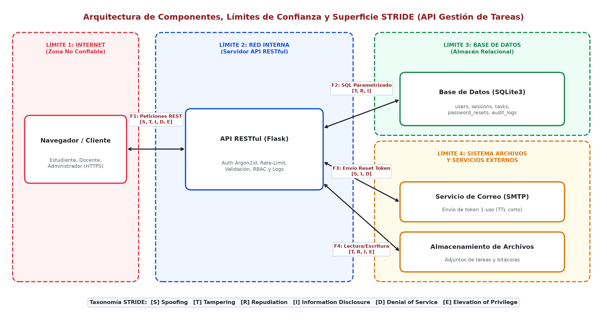
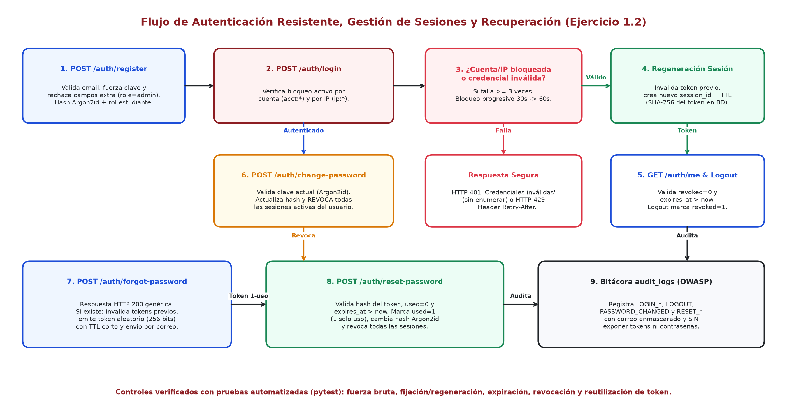

# API Web Segura de Gestión de Tareas — Guía Práctica 04 (UNSAAC)

[](https://github.com/YefersonSupa/isw2-guia04-seguridad-api/actions/workflows/ci.yml)
[](https://www.python.org/)
[](https://flask.palletsprojects.com/)
[](https://argon2-cffi.readthedocs.io/)
[](https://bandit.readthedocs.io/)
[](https://pylint.readthedocs.io/)
[](LICENSE)

Implementación segura de una **API RESTful + Frontend Web** de gestión de tareas en **Python/Flask + SQLite3**, desarrollada como proyecto base, bitácora técnica y entregable de las **Actividades 1 y 2** de la *Guía de Práctica 04: Ingeniería de software seguro* de **Ingeniería de Software II** (UNSAAC — Equipo 05).

---

## Tabla de Contenidos

- [1. Características de Seguridad Implementadas](#1-características-de-seguridad-implementadas)
- [2. Arquitectura y Flujo de Seguridad](#2-arquitectura-y-flujo-de-seguridad)
- [3. Interfaz Web (Frontend Básico) y Endpoints REST](#3-interfaz-web-frontend-básico-y-endpoints-rest)
- [4. Instalación y Ejecución Reproducible](#4-instalación-y-ejecución-reproducible)
- [5. Pruebas Automatizadas y Auditoría SAST](#5-pruebas-automatizadas-y-auditoría-sast)
- [6. Estructura del Repositorio](#6-estructura-del-repositorio)
- [7. Documentación Técnica y Bitácora](#7-documentación-técnica-y-bitácora)
- [8. Autores y Créditos (Equipo 05)](#8-autores-y-créditos-equipo-05)

---

## 1. Características de Seguridad Implementadas

- **Hashing lento moderno (`Argon2id`):** Almacenamiento de contraseñas mediante `argon2-cffi` con sal criptográfica automática (sin MD5, SHA-1 ni SHA-256 para credenciales).
- **Resistencia contra Fuerza Bruta y Enumeración:** Límite de intentos fallidos independiente por cuenta (`acct:*`) y por dirección IP (`ip:*`) con bloqueo temporal progresivo (`HTTP 429` + cabecera `Retry-After`) y mensajes uniformes (`HTTP 401`) que evitan enumeración de correos.
- **Ciclo de Vida Seguro de Sesiones:** Tokens aleatorios de 256 bits (`secrets.token_urlsafe`), almacenados en SQLite3 por digest SHA-256, con expiración (`expires_at`), regeneración obligatoria de `session_id` al iniciar sesión (anti-*Session Fixation*) y revocación global al cambiar o restablecer la contraseña.
- **Recuperación Segura de Contraseña:** Token aleatorio de un solo uso con expiración corta, invalidación previa de tokens pendientes y auditoría sin exposición del token.
- **Gestión Segura de Tareas (`/tasks`) y Defensa contra IDOR/SQLi/XSS:**
  - Consultas 100 % parametrizadas (`?` y `LIKE ? ESCAPE '\\'`).
  - Validación positiva de longitudes, estados y rechazo de campos extra (*Mass Assignment* como `role: "admin"` u `owner_id`).
  - Verificación de propiedad (`owner_id == session.user_id`) en servidor devolviendo `HTTP 403 Forbidden`.
  - Cabeceras de defensa en profundidad (`Content-Security-Policy` estricta sin `'unsafe-inline'`, `X-Content-Type-Options: nosniff`, `X-Frame-Options: DENY`, `Cache-Control: no-store`).
  - Bitácora `audit_logs` con correos enmascarados y sin payloads maliciosos ni secretos (prevención de *Log Injection*).

---

## 2. Arquitectura y Flujo de Seguridad





---

## 3. Interfaz Web (Frontend Básico) y Endpoints REST

El servidor incluye un **portal web interactivo** servido en `http://127.0.0.1:5000/` (`task_api/templates/index.html` + `static/style.css` + `static/app.js`) con:
- Pestañas de **Iniciar Sesión** (con simulación rápida de fuerza bruta), **Registro** (con simulación de ataque `role: "admin"`), **Mis Tareas** (CRUD + búsqueda parametrizada + prueba de `owner_id` extra), **Mi Sesión / Clave** y **Recuperar Clave**.
- **Inspector HTTP en Vivo** con códigos de estado, cabeceras `Retry-After` y respuestas JSON formateadas sin guardar tokens en `localStorage` ni usar `innerHTML`.

| Método | Endpoint | Propósito | Códigos de Respuesta |
|---|---|---|---|
| `GET` | `/` | Portal web interactivo (Frontend HTML/CSS/JS) | `200` |
| `POST` | `/auth/register` | Registro de cuenta con rol mínimo `estudiante` | `201`, `400` |
| `POST` | `/auth/login` | Autenticación con bloqueo progresivo y regeneración | `200`, `401`, `429` |
| `POST` | `/auth/logout` | Revocación inmediata de la sesión actual | `200`, `401` |
| `GET` | `/auth/me` | Consulta de sesión y usuario autenticado | `200`, `401` |
| `POST` | `/auth/change-password` | Cambio de clave y revocación de sesiones activas | `200`, `400`, `401` |
| `POST` | `/auth/forgot-password` | Emisión de token único (impreso solo en consola local) | `200`, `400` |
| `POST` | `/auth/reset-password` | Restablecimiento con token de 1 solo uso y TTL corto | `200`, `400` |
| `GET` | `/tasks?search=...` | Listado y búsqueda SQL parametrizada de tareas | `200`, `400`, `401` |
| `POST` | `/tasks` | Creación de tarea asignando `owner_id` desde sesión | `201`, `400`, `401` |
| `PUT` | `/tasks/<id>` | Edición verificando propiedad en servidor | `200`, `400`, `401`, `403`, `404` |
| `DELETE` | `/tasks/<id>` | Eliminación verificando propiedad y auditoría | `200`, `401`, `403`, `404` |

---

## 4. Instalación y Ejecución Reproducible

```bash
# 1. Clonar el repositorio
git clone https://github.com/YefersonSupa/isw2-guia04-seguridad-api.git
cd isw2-guia04-seguridad-api

# 2. Crear y activar entorno virtual (recomendado)
python -m venv .venv
# En Windows PowerShell:
.\.venv\Scripts\Activate.ps1
# En Linux / macOS:
# source .venv/bin/activate

# 3. Instalar dependencias
pip install --upgrade pip
pip install -r requirements.txt

# 4. Iniciar la aplicación web (Backend + Frontend)
python -m task_api.app
```

Abre tu navegador en **`http://127.0.0.1:5000/`** para utilizar la interfaz gráfica y el inspector HTTP en vivo.

---

## 5. Pruebas Automatizadas y Auditoría SAST

```bash
# Ejecutar suite completa de pruebas unitarias y negativas
pytest -v

# Ejecutar análisis estático de vulnerabilidades (SAST)
bandit -r task_api

# Verificar calidad estática y estilo de código
pylint task_api

# Ejecutar demostración HTTP end-to-end en consola
python scripts/run_http_demo.py
```

### Evidencias Verificadas
- **`pytest -v`:** **9/9 pruebas aprobadas** (`tests/test_auth_security.py` y `tests/test_tasks_security.py`).
- **`bandit -r task_api`:** **0 vulnerabilidades detectadas** (`High/Medium/Low = 0` en 1078 líneas analizadas).
- **`pylint task_api`:** **10.00 / 10**.

---

## 6. Estructura del Repositorio

```text
isw2-guia04-seguridad-api/
├── .github/workflows/ci.yml        # Pipeline CI (pytest + bandit + pylint)
├── .gitattributes                  # Normalización de fin de línea y binarios
├── .gitignore                      # Exclusión de .venv, *.db, cachés y compilados
├── LICENSE                         # Licencia MIT
├── pyproject.toml                  # Configuración de pytest, pylint y bandit
├── requirements.txt                # Dependencias reproducibles
├── README.md                       # Documentación principal del proyecto
├── docs/                           # Documentación técnica (STRIDE, PxI, RE/RF/RS)
│   ├── 01_arquitectura_y_stride.md
│   └── 02_requisitos_y_trazabilidad.md
├── task_api/                       # Código fuente modular (API + Frontend)
│   ├── __init__.py
│   ├── app.py                      # App Flask, rutas REST, frontend y cabeceras CSP
│   ├── db.py                       # Conexión y esquema SQLite3 parametrizado
│   ├── security.py                 # Argon2id, tokens 256-bit, rate-limit y auditoría
│   ├── auth_service.py             # Registro, login, logout, cambio y reset de clave
│   ├── tasks_service.py            # CRUD de tareas con validación y control IDOR
│   ├── templates/index.html        # Interfaz web HTML5
│   └── static/                     # Hoja de estilos CSS y cliente JS sin inline scripts
├── tests/                          # Pruebas unitarias, de integración y negativas
│   ├── test_auth_security.py
│   └── test_tasks_security.py
├── scripts/                        # Demostración HTTP y generadores de diagramas
│   ├── run_http_demo.py
│   └── generate_assets.py
├── capturas/                       # Diagramas y capturas reales de evidencias
├── evidencias/                     # Registros textuales de pruebas y SAST
├── informe/                        # Informe técnico institucional en LaTeX (UNSAAC)
│   ├── unsaac.jpg
│   └── main.tex
├── build_guia04_presentation.py    # Generador automatizado de presentación UNSAAC
└── export_guia04_pdf.ps1           # Exportador PowerPoint -> PDF
```

---

## 7. Documentación Técnica y Bitácora

- [Arquitectura, Modelado STRIDE y Riesgos P×I](docs/01_arquitectura_y_stride.md)
- [Requisitos Verificables y Matriz de Trazabilidad](docs/02_requisitos_y_trazabilidad.md)
- [Informe Técnico en LaTeX (UNSAAC)](informe/main.tex)
- **Bitácora Digital en Google Drive (Equipo 05):** [Carpeta Institucional](https://drive.google.com/drive/folders/1S-F9LnMze7nOk9m7HgX4QdU20abIEQLo?usp=sharing)

---

## 8. Autores y Créditos (Equipo 05)

**Universidad Nacional de San Antonio Abad del Cusco (UNSAAC)**  
*Escuela Profesional de Ingeniería Informática y de Sistemas — Ingeniería de Software II*  
**Docente:** Ing. Edwin Alvarez Mamani

| N.º | Apellidos y Nombres | Código | Contribución Principal |
|---:|---|---|---|
| 1 | SUPA CUSIPAUCAR, Yeferson | 220553 | Arquitectura segura, API Flask, Frontend Web y pruebas automatizadas |
| 2 | VILLAVICENCIO SEGUIL, Edu Piero | 220555 | Modelado STRIDE, evaluación de riesgos P×I y diagramación |
| 3 | MAMANI ZANABRIA, Jefersson | 170438 | Especificación de requisitos verificables (`RE-01`..`RE-04`) |
| 4 | QUISPE LOCUMBER, Aldo | 220610 | Matriz de trazabilidad (`RF`/`RS`), activos y criterios de aceptación |
| 5 | NIÑO DE GUZMÁN CONDE, Wendel Yovan | 192426 | Auditoría SAST (`Bandit`/`Pylint`), evidencias y documentación |
