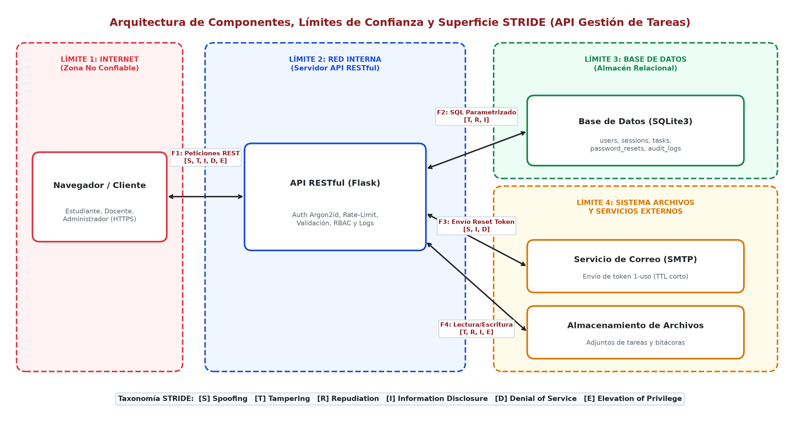
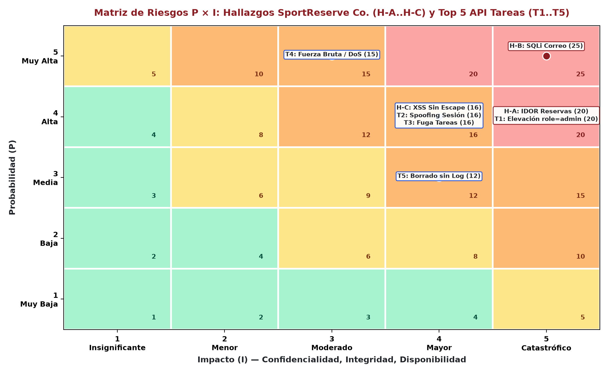

# Arquitectura de Seguridad, Modelado STRIDE y Análisis de Riesgos (P×I)

Documentación técnica de la **Actividad 1** y **Ejercicio Propuesto 1.1** de la Guía de Práctica 04 (*Ingeniería de Software II — UNSAAC*).

## 1. Caso Práctico 01: SportReserve Co. (Matriz P×I)

Escala de evaluación: `1–4: Bajo` | `5–9: Medio` | `10–16: Alto` | `17–25: Crítico`.

| Hallazgo | Categoría STRIDE | Actor / Vulnerabilidad | P | I | Riesgo (P×I) | Control Prioritario |
|---|---|---|---:|---:|---|---|
| **Hallazgo A:** Alterar `/reservas?id=104` por `105` expone datos ajenos | Elevation of Privilege / Information Disclosure | Usuario autenticado malicioso (IDOR) | 4 | 5 | **20 (Crítico)** | Verificar `reserva.user_id == session.user_id` en servidor; responder `HTTP 403 Forbidden`. |
| **Hallazgo B:** Búsqueda por correo sin parametrización SQL | Tampering / Information Disclosure | Atacante externo (SQL Injection) | 5 | 5 | **25 (Crítico)** | Sentencias SQL parametrizadas (*Prepared Statements*) + validación positiva de correo. |
| **Hallazgo C:** Comentarios/nombres sin filtro de salida | Tampering / Information Disclosure | Usuario externo (XSS Reflejado/Almacenado) | 4 | 4 | **16 (Alto)** | Escapado contextual (`markupsafe.escape`) + cabecera `Content-Security-Policy`. |

---

## 2. Arquitectura y Límites de Confianza (API Gestión de Tareas)

### Límites de Confianza Identificados
1. **Límite 1 — Internet (Zona No Confiable):** Navegador/cliente interactuando por HTTP/JSON con credenciales, tokens Bearer y carga útil de tareas.
2. **Límite 2 — Red Interna (Servidor API RESTful Flask):** Capa de validación positiva, hashing **Argon2id**, limitador de intentos por cuenta e IP, autorización por propiedad (`owner_id`) y cabeceras de defensa en profundidad.
3. **Límite 3 — Base de Datos Relacional (SQLite3):** Almacenamiento de tablas `users`, `sessions`, `login_attempts`, `password_resets`, `tasks` y `audit_logs`, accedidas 100 % mediante placeholders `?`.
4. **Límite 4 — Servicios Externos y Almacenamiento:** Servicio SMTP para envío de tokens de recuperación de un solo uso y almacenamiento aislado de adjuntos/bitácoras.

---

## 3. Plan de Mitigación Priorizado (Top 5 Amenazas Críticas)

1. **T1 — Elevación de privilegios vía *Mass Assignment* (`4×5 = 20 Crítico`):** Lista blanca estricta de campos JSON; rechazo `HTTP 400` ante `role` u `owner_id` no esperados.
2. **T2 — Suplantación y fijación de sesión (`4×4 = 16 Alto`):** Tokens criptográficos de 256 bits almacenados por digest SHA-256, regeneración de `session_id` tras login y expiración estricta.
3. **T3 — Divulgación de tareas ajenas / IDOR (`4×4 = 16 Alto`):** Filtrado por `owner_id` en consultas y verificación de propiedad en servidor (`HTTP 403 Forbidden`).
4. **T4 — Fuerza bruta y agotamiento de recursos (`5×3 = 15 Alto`):** Bloqueo temporal progresivo por cuenta e IP (`HTTP 429` + `Retry-After`) y límite `MAX_CONTENT_LENGTH` (`16 KiB`).
5. **T5 — Repudio / eliminación sin registro (`3×4 = 12 Alto`):** Bitácora inmutable `audit_logs` con eventos de autenticación, validación fallida y eliminación sin exponer secretos.
