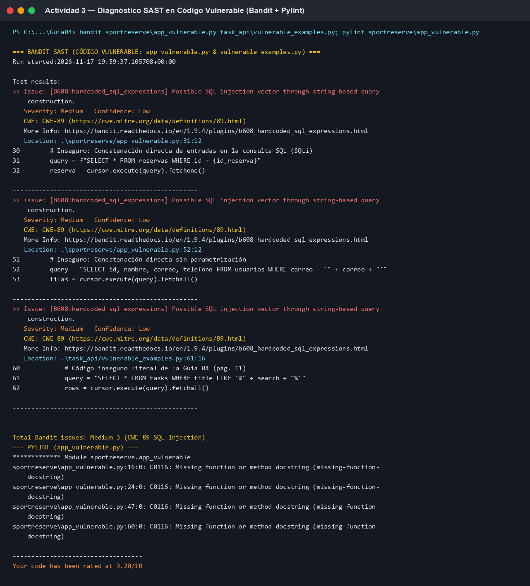
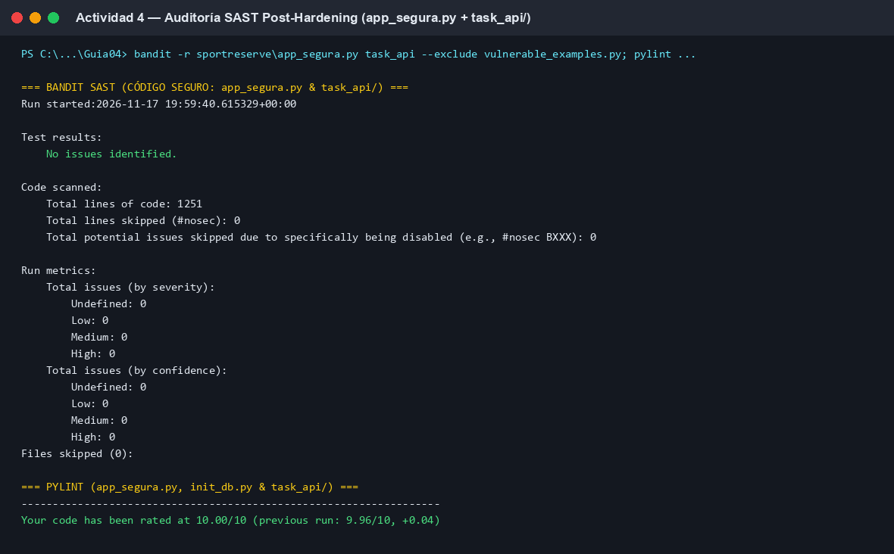
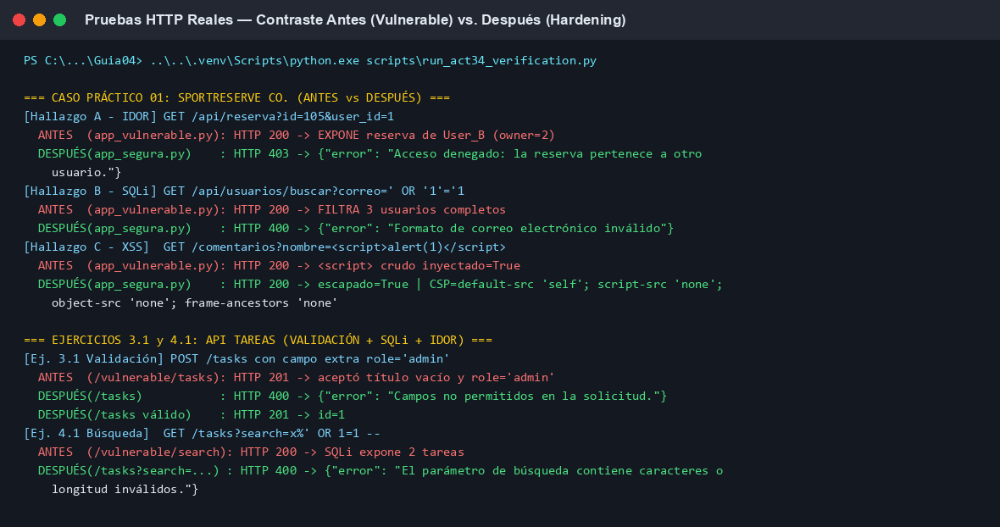

# Diagnóstico SAST, Validación en Servidor y Hardening (Actividades 3 y 4)

Documentación técnica de la **Actividad 3**, **Ejercicio Propuesto 3.1**, **Actividad 4** y **Ejercicio Propuesto 4.1** de la Guía de Práctica 04 (*Ingeniería de Software II — UNSAAC*).

---

## 1. Actividad 3: Despliegue y Diagnóstico SAST (`sportreserve/app_vulnerable.py`)

Se implementó fielmente `sportreserve/app_vulnerable.py` junto con `sportreserve/init_db.py` (`reservas.db` con `id=104` de `User_A` e `id=105` de `User_B`), reproduciendo los tres hallazgos críticos y ejecutando análisis estático con **Bandit** y **Pylint**.

### Líneas Exactas Afectadas Detectadas

| Hallazgo | Archivo y Línea | Vulnerabilidad / CWE | Alerta SAST / Diagnóstico |
|---|---|---|---|
| **Hallazgo A (SQLi)** | `sportreserve/app_vulnerable.py:31` | `f"SELECT * FROM reservas WHERE id = {id_reserva}"` (CWE-89) | Bandit `B608` (Medium): construcción de consulta SQL mediante f-string. |
| **Hallazgo A (IDOR)** | `sportreserve/app_vulnerable.py:39` | Retorno directo de `dict(reserva)` sin validar `user_id_session` (CWE-639) | Brecha lógica de autorización confirmada mediante prueba negativa HTTP (200 en vez de 403). |
| **Hallazgo B (SQLi)** | `sportreserve/app_vulnerable.py:52` | `"SELECT ... WHERE correo = '" + correo + "'"` (CWE-89) | Bandit `B608` (Medium): concatenación directa con `+`. |
| **Hallazgo C (XSS)** | `sportreserve/app_vulnerable.py:78-79` | `render_template_string(html)` sin escapado contextual (CWE-79) | Inyección HTML/JS reflejada y almacenada verificada en pruebas DAST (`<script>` crudo). |
| **Ej. 4.1 (SQLi)** | `task_api/vulnerable_examples.py:61` | `"SELECT * FROM tasks WHERE title LIKE '%" + search + "%'"` (CWE-89) | Bandit `B608` (Medium): alteración de sintaxis SQL mediante `%' OR 1=1 --`. |



---

## 2. Ejercicio Propuesto 3.1: Validación Robusta en Servidor (`POST /tasks`)

### Comparación Antes vs. Después
- **Antes (`task_api/vulnerable_examples.py`):** Aceptaba títulos vacíos, estados arbitrarios (`"hacked"`), y campos inyectados como `role: "admin"` u `owner_id` sin validación ni límite de tamaño.
- **Después (`task_api/tasks_service.py` y `task_api/app.py`):**
  - `title`: obligatorio, entre **3 y 120 caracteres** (recortado y soportando Unicode/espacios).
  - `description`: opcional, máximo **1 000 caracteres**.
  - `status`: lista blanca estricta (`pendiente`, `en_progreso`, `completada`).
  - Rechazo explícito (`HTTP 400`) de campos desconocidos (`role: "admin"`, `owner_id`).
  - Límite de tamaño global `MAX_CONTENT_LENGTH = 16 KiB` (`HTTP 413 Payload Too Large`).
  - **Logging seguro OWASP:** Registra advertencia `TASK_VALIDATION_FAILED` con la categoría y el nombre del parámetro rechazado (`extra_field:role`), **sin guardar el payload completo malicioso** (mitigando *Log Injection*).

---

## 3. Actividad 4: Refactorización y Hardening (`sportreserve/app_segura.py`)

Controles de defensa en profundidad aplicados sobre `app_vulnerable.py`:
1. **Validación positiva (`HTTP 400`):** Verifica `id_reserva.isdigit()`, `user_id_session.isdigit()` y formato estricto de correo (`EMAIL_PATTERN`).
2. **Consultas parametrizadas (`?`):** Reemplaza toda concatenación/f-string por *Prepared Statements* con tuplas de parámetros.
3. **Autorización en servidor (`HTTP 403`):** Comprueba `int(reserva["user_id"]) == int(user_id_session)`; ante discrepancia aborta con `HTTP 403 Forbidden` sin filtrar datos.
4. **Escapado contextual XSS + CSP:** Emplea `markupsafe.escape()` sobre toda cadena renderizada en HTML y agrega `Content-Security-Policy: default-src 'self'; script-src 'none'; object-src 'none'; frame-ancestors 'none'`.



---

## 4. Ejercicio Propuesto 4.1: Eliminación de SQL por Concatenación en Búsquedas

- **Código inseguro ("Antes"):**
  ```python
  query = "SELECT * FROM tasks WHERE title LIKE '%" + search + "%'"
  ```
  *Riesgo:* El atacante cierra el literal con `%' OR 1=1 --`, alterando el árbol sintáctico de la consulta y extrayendo registros de todos los usuarios.
- **Código seguro ("Después" en `task_api/tasks_service.py`):**
  ```python
  escaped_term = term.replace("\\", "\\\\").replace("%", "\\%").replace("_", "\\_")
  like_pattern = f"%{escaped_term}%"
  rows = conn.execute(
      "SELECT id, title, description, status, owner_id, created_at "
      "FROM tasks WHERE owner_id = ? AND title LIKE ? ESCAPE '\\' ORDER BY id DESC",
      (session["user_id"], like_pattern),
  ).fetchall()
  ```
  *(En SQLite3 el placeholder posicional es `?`, equivalente a `%s` en PostgreSQL/MySQL).*
- **Auditoría automatizada:** El test `test_no_sql_concatenation_in_production_modules` + Bandit (`0 issues` en 1251 líneas) garantizan cero concatenaciones SQL en toda la aplicación productiva.


