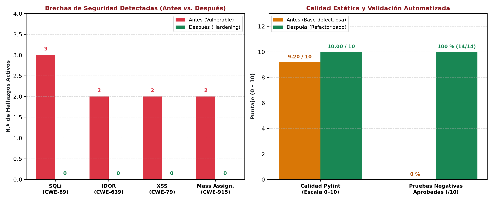

# Análisis Metacognitivo, Reto Complejo de Extensión y Resultados

Consolidado final de reflexión técnica, reto de extensión RBAC y tabla oficial de verificación automatizada para la Guía de Práctica 04 (*Equipo 05 — UNSAAC*).

---

## 1. Análisis Metacognitivo (Causas Raíz y Defensa en Profundidad)

1. **¿Por qué `pylint` calificó con 9.20/10 a `app_vulnerable.py` y Bandit no detectó el IDOR?**
   - **Causa raíz:** Los analizadores estáticos basados en reglas sintácticas (SAST ligero como Bandit/Pylint) identifican eficazmente patrones peligrosos locales (como concatenación SQL `B608`), pero carecen de contexto semántico sobre las reglas de negocio (quién es dueño de qué reserva). Por ello, la verificación de seguridad exige combinar **SAST + pruebas negativas dinámicas (DAST/pytest)** para detectar fallas lógicas de autorización (IDOR) y renderización HTML insegura (XSS).
2. **¿Por qué la validación de entrada complementa, pero NO sustituye, a las consultas parametrizadas?**
   - **Causa raíz:** Las listas negras o filtros de caracteres pueden ser evadidos mediante codificaciones alternativas o bloquear datos legítimos (como apellidos con apóstrofe `O'Connor`). Las consultas parametrizadas (*Prepared Statements*) resuelven el problema en la raíz separando el **plano de instrucciones SQL** del **plano de datos** a nivel del motor relacional; la validación positiva agrega una segunda capa (*Defensa en Profundidad*) que reduce la superficie de ataque y evita datos malformados.
3. **¿Por qué el registro de eventos de validación fallida debe omitir el payload completo (OWASP)?**
   - **Causa raíz:** Almacenar entradas no confiables en logs abre la puerta a **Log Injection / CRLF Injection** (falsificación de líneas de auditoría), exposición accidental de credenciales y ataques XSS si las bitácoras se visualizan en un panel web administrativo. Registrar únicamente la regla violada (`extra_field:role`) y el correo enmascarado (`u***@unsaac.edu.pe`) preserva trazabilidad forense sin ampliar el riesgo.

---

## 2. Reto Complejo de Extensión Implementado: RBAC Multi-Rol + Guardia Estática

Para superar los requisitos básicos de la guía se implementaron y verificaron dos controles avanzados:
- **Separación de Privilegios RBAC (`estudiante`, `docente`, `administrador`):**
  - `estudiante`: aislamiento estricto por `owner_id` (solo lee, edita y elimina sus tareas; cualquier intento ajeno responde `HTTP 403` y registra `IDOR_TASK_*_DENIED`).
  - `docente`: capacidad de supervisión en modo **solo lectura** (`GET /tasks`), pero bloqueo estricto `HTTP 403 Forbidden` si intenta modificar o eliminar tareas de estudiantes.
  - `administrador`: gestión integral con trazabilidad obligatoria en `audit_logs`.
- **Guardia Estática Anti-Concatenación SQL en CI:** Prueba automatizada `test_no_sql_concatenation_in_production_modules` integrada al pipeline de GitHub Actions que bloquea cualquier PR que introduzca f-strings o concatenación `+` en consultas SQL.

---

## 3. Tabla Consolidada de Verificación y Resultados (14/14 Aprobadas)

| ID Prueba | Módulo / Escenario Evaluado | Resultado Esperado | Resultado Obtenido | Estado |
|---|---|---|---|---|
| **PT-01** | Registro con Argon2id y bloqueo `role="admin"` | Hash `$argon2id$`; extra → `HTTP 400` | Verificado en SQLite y `HTTP 400` | **PASA** |
| **PT-02** | Credenciales inválidas sin enumeración | Mismo `HTTP 401` genérico | Respuestas idénticas | **PASA** |
| **PT-03** | Fuerza bruta por cuenta e IP | `HTTP 429` + `Retry-After` progresivo (`30s→60s`) | Bloqueo progresivo verificado | **PASA** |
| **PT-04** | Regeneración, expiración y logout de sesión | Nuevo `session_id`; expirado/cerrado → `HTTP 401` | Token previo invalidado y `HTTP 401` | **PASA** |
| **PT-05** | Revocación de sesiones al cambiar clave | Sesiones previas → `HTTP 401` | Todas las sesiones revocadas | **PASA** |
| **PT-06** | Reset con token 1-uso, expiración y logs limpios | Reuso/vencido → `HTTP 400`; 0 tokens en logs | Verificado en `audit_logs` | **PASA** |
| **PT-07** | Frontend HTML y cabeceras CSP estrictas | `HTTP 200`, `script-src 'self'`, `DENY`, `nosniff` | Verificado sin `'unsafe-inline'` | **PASA** |
| **PT-08** | Reproducción controlada en `app_vulnerable.py` | Reproduce IDOR (`200`), SQLi (3 filas) y XSS | 3 hallazgos reproducidos | **PASA** |
| **PT-09** | Hardening completo en `app_segura.py` | IDOR → `403`, SQLi → `400`, XSS escapado + CSP | 100 % mitigado | **PASA** |
| **PT-10** | Contraste versión insegura `/vulnerable/tasks` | Acepta `role="admin"` y sufre SQLi `%' OR 1=1 --` | Brecha evidenciada antes | **PASA** |
| **PT-11** | Validación `POST /tasks` + `MAX_CONTENT_LENGTH` | Vacío/largo/estado/extra → `400`, >16KiB → `413` | 7 rechazos auditados sin payload | **PASA** |
| **PT-12** | IDOR y búsqueda parametrizada `GET /tasks` | Ajeno → `403`; SQLi/comillas/largo → `400`; nulos → `200` | Todos los casos borde aprobados | **PASA** |
| **PT-13** | Reto RBAC (`estudiante` / `docente` / `admin`) | Docente lee pero recibe `403` en editar/borrar | Separación de roles validada | **PASA** |
| **PT-14** | Guardia anti-concatenación SQL + SAST | 0 concatenaciones SQL; Bandit 0; Pylint 10.00/10 | 0 alertas en 1251 líneas | **PASA** |
